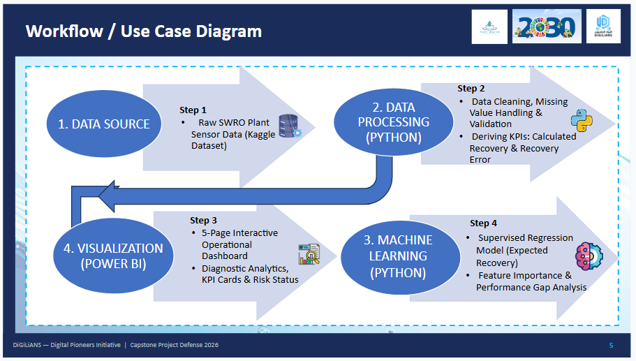
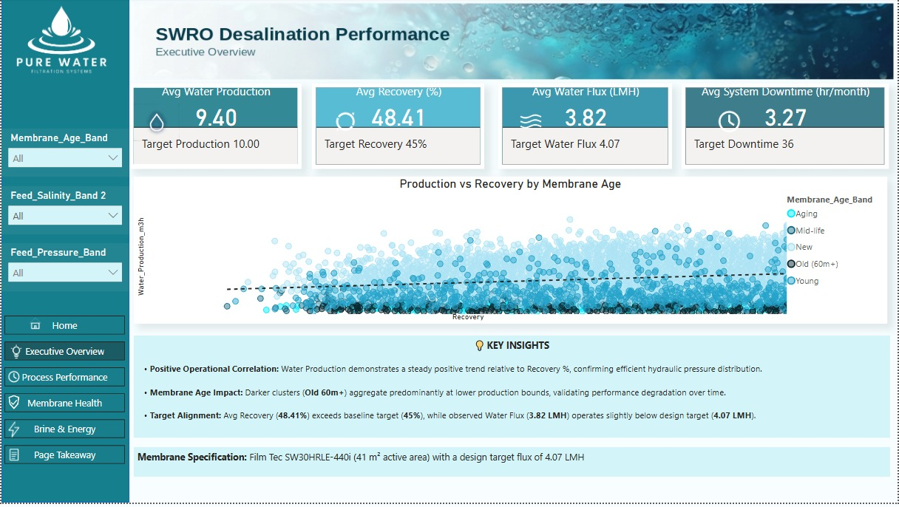
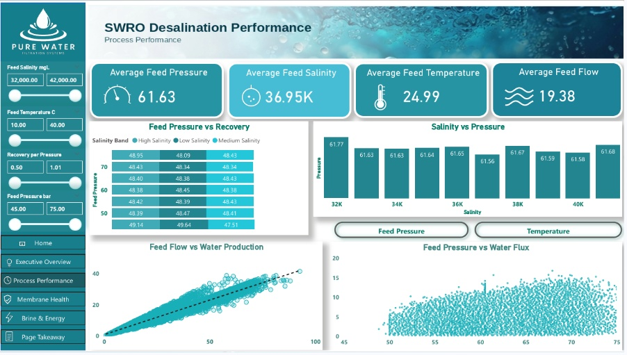
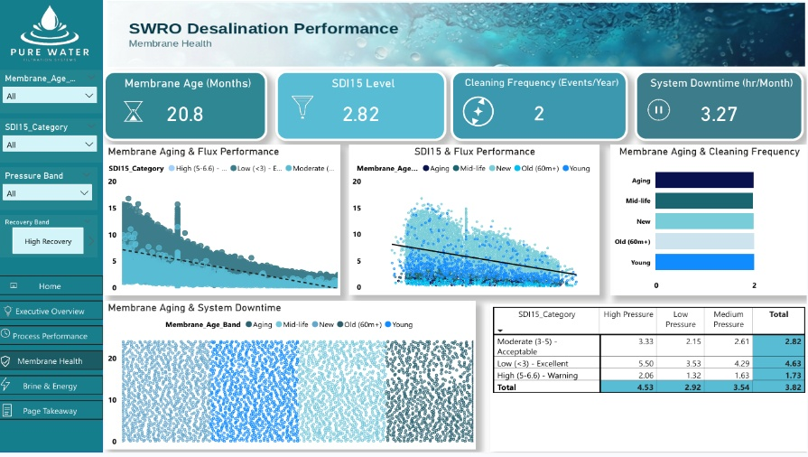
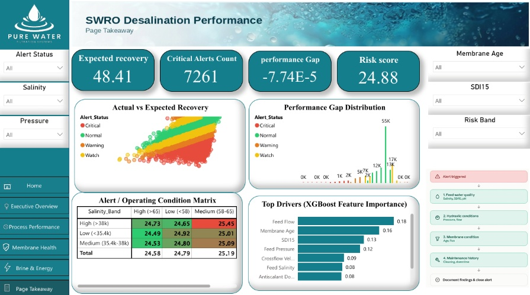

# 💧 SWRO Desalination: Data-Driven Performance Analytics

> **Capstone Project — DiGiLIANS (Digital Pioneers Initiative) | Aligned with Egypt Vision 2030**

An end-to-end analytics and decision-support system that turns raw Seawater Reverse Osmosis (SWRO) sensor data into actionable operational insights. Built on **156,234 sensor readings** covering feed water quality, operating pressure, membrane age, and reliability indicators, this project combines Python-based data preparation, SQL, an interactive Power BI dashboard, and an **XGBoost** machine learning model to transition desalination plants from fixed, age-based maintenance to **condition-based decisions**.

---

## 🎯 Problem Statement & Motivation
Water scarcity in Egypt and water quality challenges in coastal areas make reliable, efficient desalination critical for communities and tourism. Many desalination plants still rely on manual data collection, lack real-time monitoring, and suffer from unexpected shutdowns and high operational costs.

This project answers a core operational question with direct cost implications:
> **What really drives membrane performance loss and downtime — membrane age or operating conditions?**

---

## 🔄 End-to-End Architecture & Workflow

1. **Data Source:** Raw SWRO plant sensor readings (`desalination_sensor_data` from Kaggle — 156,234 records).
2. **Data Processing (Python & SQL):** Data cleaning, missing value handling, validation, **18% sensor error reduction**, and KPI derivation (Calculated Recovery & Recovery Error).
3. **Machine Learning (XGBoost):** Supervised regression model predicting expected recovery, computing the performance gap, and extracting feature importance.
4. **Visualization (Power BI & DAX):** Interactive multi-page operational dashboard with `< 2s` response time, diagnostic analytics, KPI cards, and risk status tracking.

---

## 🔍 Key Analytical Insights
* **Operating Conditions vs. Membrane Age:** Statistical analysis shows that membrane age has almost no relationship with system downtime ($r \approx 0.002$), whereas feed water quality (**SDI15**) has a clear negative relationship with membrane flux ($r \approx -0.41$).
* **High-Risk Operating Zone:** Heatmap analysis pinpoints the highest-risk operating zone at **high SDI15 (5–6.6) combined with low operating pressure**, where average flux drops to **1.32 LMH** (compared to **5.50 LMH** under low SDI15 and high pressure).
* **Energy Recovery Opportunity:** Peak efficiency occurs at high operating pressure, opening a direct opportunity for energy recovery in the brine stream.
* **Membrane Benchmark (Film Tec SW30HRLE-440i — $41\ \text{m}^2$ active area):**
  * **Avg Recovery:** `48.41%` *(Exceeds 45% target)*
  * **Avg Water Flux:** `3.82 LMH` *(Design target: 4.07 LMH)*
  * **Avg Water Production:** `9.40` $\text{m}^3/\text{h}$ *(Target: `10.00` $\text{m}^3/\text{h}$)*
  * **Avg System Downtime:** `3.27 hr/month`

---

## 🤖 Predictive Alert System (XGBoost)
An **XGBoost** regression model predicts expected recovery from real-time operating conditions. The gap between actual and expected recovery (mean gap: $-7.74 \times 10^{-5}$) drives a **4-level operational alert system**:
1. 🟢 **Normal**
2. 🟡 **Watch**
3. 🟠 **Warning**
4. 🔴 **Critical** (`7,261` critical alerts flagged, overall average Risk Score: `24.88`)

### Top Performance Drivers (XGBoost Feature Importance)
| Rank | Feature | Importance Score |
| :--- | :--- | :---: |
| 1 | **Feed Flow** | `0.18` |
| 2 | **Membrane Age** | `0.16` |
| 3 | **SDI15 (Feed Water Quality)** | `0.13` |
| 4 | **Feed Pressure** | `0.12` |
| 5 | **Crossflow Velocity** | `0.09` |
| 6 | **Feed Salinity** | `0.08` |
| 7 | **Antiscalant Dose** | `0.08` |

---

## 📊 Power BI Dashboard Preview

### 1. Executive Overview
High-level KPIs, target alignment, and production vs. recovery trends across membrane age bands.

### 2. Process Performance
Monitors average feed pressure (`61.63 bar`), salinity (`36.95K mg/L`), temperature ($24.99^\circ\text{C}$), and feed flow (`19.38`), alongside pressure-to-recovery heatmaps.

### 3. Membrane Health
Tracks average membrane age (`20.8 months`), SDI15 (`2.82`), cleaning frequency (`2 events/year`), and the SDI15 vs. Pressure risk matrix.

### 4. Page Takeaway (ML Predictions & Alerting)
Displays actual vs. expected recovery, performance gap distribution, operating condition alert matrix, XGBoost feature importance, and a 4-step operational response checklist.

---

## 🛠️ Tech Stack
* **Programming & ML:** Python (`Pandas`, `NumPy`, `Matplotlib`, `Scikit-learn`, `XGBoost`)
* **Database:** SQL
* **Business Intelligence:** Microsoft Power BI, DAX, Data Modeling

---

## 📈 Business Impact
* Moves plant operations from **fixed, age-based maintenance** to **condition-based predictive maintenance**.
* Reduces unplanned downtime, maintenance costs, and wasted energy.
* Enhances water production reliability for coastal communities and tourism.
